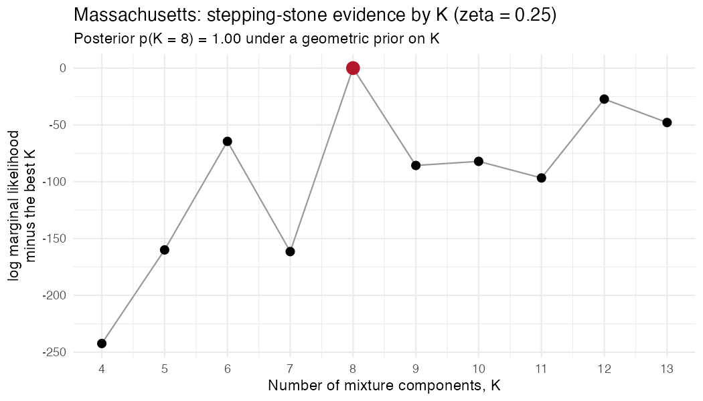
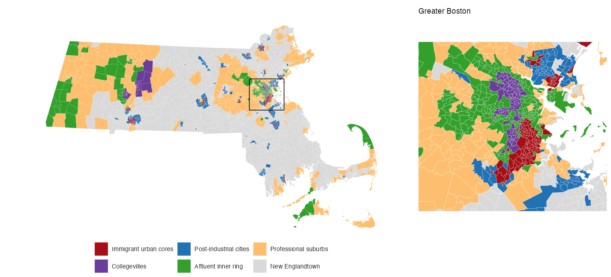
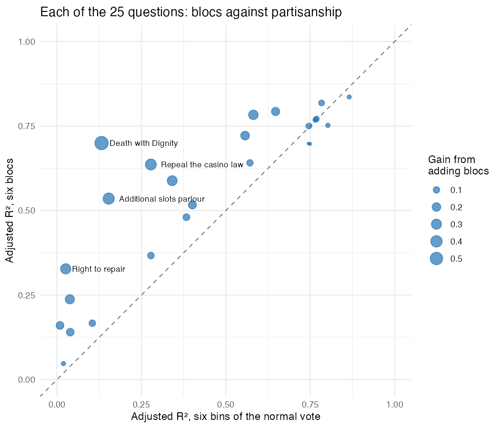
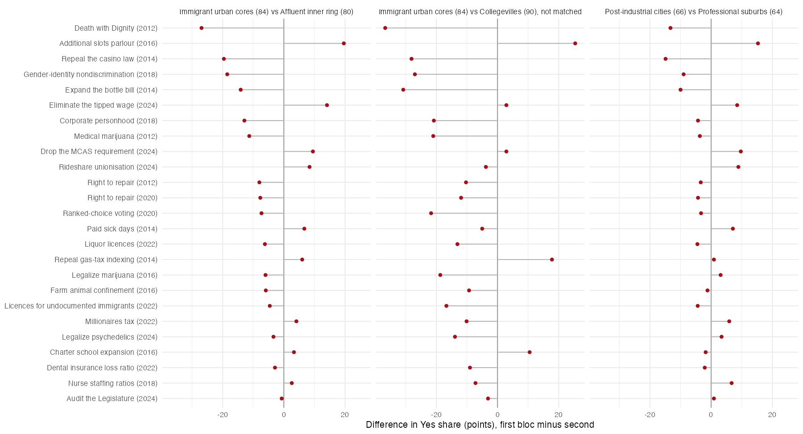

# Worked example: Massachusetts

Massachusetts is the paper's case of local politics that does *not* reduce to national partisanship. Its precincts vote on statewide questions about end-of-life care, casinos, the bottle bill and ballot access, many of which the parties take no clear position on. This example takes the stepping-stone (fully Bayesian) fit from the paper, turns its posterior into one bloc map, and repeats the paper's Massachusetts analysis from the public data:
- how much national partisanship explains;
- what the blocs add;
- the partisan-matched pairs;
- two tests on elections the model never saw.

```sh
Rscript examples/massachusetts/ma_example.R            # about 15 seconds
MA_RUN_EM=1 Rscript examples/massachusetts/ma_example.R # also refits tempered EM for K = 2..12: about 12 minutes on 10 cores
```

It needs [Elections.BBMM](https://github.com/cascobayesian/Elections.BBMM) (`remotes::install_github("cascobayesian/Elections.BBMM")`), **cluster**, **sf**, **ggplot2** and **patchwork**, and writes everything to [`output/`](output/).

## 1. The data

```r
source("R/read_place.R")
d   <- read_place("ma")                    # Yes votes and Yes + No totals, precinct x question
fed <- read_place("ma", "federal_races")   # Democratic and Dem + Rep votes, President and US Senate
d
#> BBMM data: 2392 units x 25 questions, 71,130,953 votes; 3.8% of cells empty
```

The 25 questions are every statewide ballot question from 2012 to 2024, on the 2,392 precincts of the 2022 map; earlier years were moved onto that map ([`data/ma/DATA.md`](../../data/ma/DATA.md)). The **normal vote** of a precinct is its mean two-party Democratic share over the ten presidential and Senate races of the same years. It is used only to evaluate the blocs, never to estimate them.

## 2. How many blocs? The stepping-stone evidence

For each number of mixture components *K*, `bbmm_ss()` runs a sequential Monte Carlo sampler from the prior to the coarsened posterior (ζ = 0.25), and its stepping-stone estimate of the marginal likelihood *p*(data | *K*) gives the posterior on *K*. One run at Massachusetts's size takes three to four hours, so the paper's runs were made on a cluster. [`ss_evidence.csv`](ss_evidence.csv) holds their results, with the package defaults and the seeds used:

```r
fit8 <- bbmm_ss(d, K = 8, zeta = 0.25, seed = 2034, n_threads = 16)   # one row of ss_evidence.csv: ~4 hours
```

A rerun gives a statistically equivalent fit, not an identical one: the cluster's input listed the precincts in a different order.

```r
ev <- read.csv("examples/massachusetts/ss_evidence.csv")
posterior_K(ev$logZ, ev$K, log_prior_K_geometric(ev$K))
#>  K   4      5      6      7     8      9     10     11     12     13
#>  logZ - best: -242  -160   -65  -162     0    -86    -82    -97    -27    -48
#>  posterior:      0      0      0     0     1      0      0      0      0      0
```



*K* = 8 has the highest evidence. **Treat the margin with care.** Each value comes from a single run, and a single run's log marginal likelihood carries Monte Carlo error of tens of log units (replicate runs for Portland differ by ±20–40). That is about the gap to *K* = 12 (27), so the runs separate *K* = 8 clearly from *K* ≤ 7 but not firmly from *K* = 12. Replicate runs per *K* would settle it. The fast route agrees: tempered EM at the same ζ (`MA_RUN_EM=1`) also picks eight, by both BIC and the 3% minimum-bloc-size rule.

## 3. From particles to one map

The *K* = 8 run ends with 200 weighted particles, each a full assignment of precincts to blocs, in [`ss_particles_K08.rds`](ss_particles_K08.rds). To summarize them in one map:
- count how often each pair of precincts shares a bloc, weighted by the particle weights (the co-occupancy matrix *S*);
- cluster the precincts by k-medoids on 1 − *S*, with as many blocs as the posterior mode of occupied blocs (*T* = 8, posterior probability 0.98).

```r
#>  component precincts normal_vote silhouette certainty
#>          4       113        89.6       0.86      0.94
#>          8       230        84.0       0.80      0.91
#>          3       295        79.6       0.70      0.84
#>          5       332        66.5       0.62      0.79
#>          2       503        64.3       0.64      0.79
#>          6        50        56.6      -0.27      0.54
#>          1       865        50.3       0.74      0.94
#>          7         4        49.0       0.99      1.00
```

Six of the eight are solid blocs. The other two are not coalitions:
- One holds 4 precincts, three in Bellingham and one in Wilmington.
- One holds 50 precincts scattered across 30 towns, with a negative silhouette: its precincts sit closer to other blocs than to each other.

The script folds each into the remaining bloc nearest it in normal vote, New Englandtown in both cases, as the paper does. That leaves the paper's six blocs exactly ([`output/blocs.csv`](output/blocs.csv) has every precinct's bloc and certainty). Before the fold, one precinct differs from the paper's eight-bloc map; it is in one of the two folded blocs, so the six-bloc partition is identical.

## 4. The six blocs



| Bloc | Precincts | Normal vote (% Dem) | Where |
|---|---|---|---|
| 1 Immigrant urban cores | 230 | 84.0 | Lawrence, Chelsea, Boston's Mattapan, Roxbury and Dorchester; parts of Springfield, Worcester, Lowell, Lynn and Brockton |
| 2 Collegevilles | 113 | 89.6 | Most of Cambridge, Somerville and Northampton; Amherst; Jamaica Plain and Allston |
| 3 Post-industrial cities | 332 | 66.5 | Most of Worcester, Fall River and New Bedford; Everett |
| 4 Affluent inner ring | 295 | 79.6 | Newton, Arlington, Brookline, Watertown, Belmont; Boston's central neighborhoods; Provincetown |
| 5 Professional suburbs | 503 | 64.3 | Andover, Needham, Winchester, Natick; West Roxbury and Charlestown |
| 6 New Englandtown | 919 | 50.6 | Small towns and outer suburbs: Plymouth, Billerica, Braintree |

The names and numbers are the paper's. The script attaches them by ordering the blocs on normal vote and checks the bloc sizes against the paper's.

## 5. What the blocs add to partisanship

For each question, across precincts and weighted by ballots, the script computes three things, exactly as in the paper's Table 2:
- the *r*² of the Yes share with the normal vote;
- the adjusted *R*² from six equal-count bins of the normal vote, and from the six blocs (the same degrees of freedom);
- the gain in adjusted *R*² from adding the blocs to a linear regression on the normal vote.

```r
#> Median |r| with the normal vote 0.62; 8 of 25 questions have r^2 < 0.25
#> Median adjusted R^2: 6 bins of the normal vote 0.40, 6 blocs 0.64; blocs explain more on 21 of 25
#> Median gain from adding the blocs to the normal vote: 0.11
```



National partisanship leaves 62% of the variance in the median question unexplained, the most of the paper's ten core places. Blocs estimated without any partisan information explain more than the binned normal vote on 21 of the 25 questions. The largest gains are the paper's characteristic ballots ([`output/questions_vs_partisanship.csv`](output/questions_vs_partisanship.csv)):

| Question | *r*² with normal vote | Adjusted *R*², blocs | Gain from adding blocs |
|---|---|---|---|
| 2012 Death with Dignity | 0.12 | 0.70 | 0.58 |
| 2016 Additional slots parlor | 0.15 | 0.54 | 0.38 |
| 2014 Repeal the casino law | 0.27 | 0.64 | 0.36 |

## 6. Partisan-matched pairs

Two blocs are *partisan-matched* when their mean normal votes are within five points: a poll or model weighted by partisanship would treat them as the same electorate. Massachusetts has two such pairs ([`output/pair_gaps.csv`](output/pair_gaps.csv)):

```r
#> Immigrant urban cores (84) vs Affluent inner ring (80): mean gap 9.2 points, more than 10 on 8 of 25;
#>   largest: Death with Dignity -27; Additional slots parlor +20; Repeal the casino law -20
#> Post-industrial cities (66) vs Professional suburbs (64): mean gap 6.0 points;
#>   largest: Additional slots parlor +15; Repeal the casino law -15; Death with Dignity -13
#> Immigrant urban cores (84) vs Collegevilles (90), not matched: mean gap 15.1 points, more than 10 on 17 of 25;
#>   largest: Death with Dignity -37; Expand the bottle bill -31; Repeal the casino law -28
```



The splits are about end-of-life care, gambling and gender identity, not about the economy. Immigrant urban cores and the Affluent inner ring vote within 10 points on the millionaires tax and paid sick leave. Collegevilles, six points more Democratic than Immigrant urban cores and so just outside the five-point rule, differ from them more sharply still.

## 7. Out of sample: a primary and local questions

The model saw only the 25 statewide questions, so other elections on the same precincts test the blocs out of sample.

**The 2022 Democratic primary for governor.** Sonia Chang-Díaz had withdrawn but remained on the ballot against Maura Healey.

```r
#> r^2 with the normal vote 0.10; adjusted R^2, 6 bins 0.11, 6 blocs 0.44
#> Chang-Díaz's share: Immigrant urban cores 29.7, Post-industrial cities 20.2, Collegevilles 16.5, ...
```

Partisanship explains a tenth of the variance and the blocs 44%. Chang-Díaz ran 13 points better in Immigrant urban cores than in Collegevilles, two overwhelmingly Democratic blocs. The data are in [`data/ma/other/primaries_2022_2024.csv.gz`](../../data/ma/other/).

**Local district questions.** These are non-binding questions put to voters in single legislative districts, 2012–2024 ([`data/ma/other/`](../../data/ma/other/)). The table gives the median gain in adjusted *R*² from adding the blocs to the normal vote, by topic ([`output/local_questions_bloc_gain.csv`](output/local_questions_bloc_gain.csv)):

| Topic | Questions | Median gain (points) |
|---|---|---|
| Legislative transparency (public committee votes) | 33 | 5.4 |
| Overturn *Citizens United* | 47 | 2.8 |
| Single-payer health care | 35 | 1.5 |
| Climate and energy | 23 | 0.1 |

The blocs add the most where partisanship says the least. Transparency in the legislature has no party position; single-payer and climate policy do. The paper, working from the project's internal files, reports 6 points for transparency against 1.5 for single-payer.

## 8. Going further

- **The posterior in more detail.** `bloc_summary()` on a `bbmm_ss` fit gives each precinct's membership probabilities and each bloc's profile with credible intervals. It picks its representative partition differently: the single particle closest to the co-occupancy matrix (Binder loss), not k-medoids on it. On these particles that partition is close to, but not the same as, the one above (adjusted Rand index 0.80 with the six blocs). The paper uses k-medoids, which can produce a partition no single particle contains.
- **Every place.** Every other place in [`data/`](../../data/) loads the same way. [`examples/san_francisco/`](../san_francisco/) shows the tempered-EM workflow from scratch.
