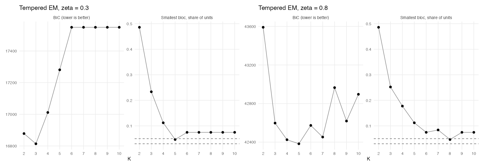
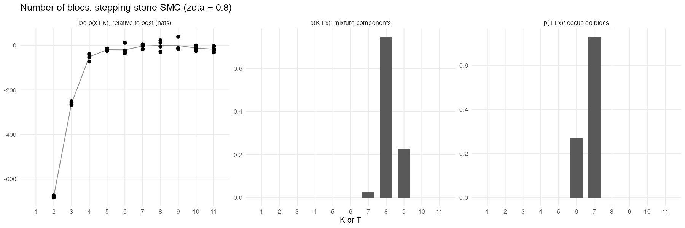
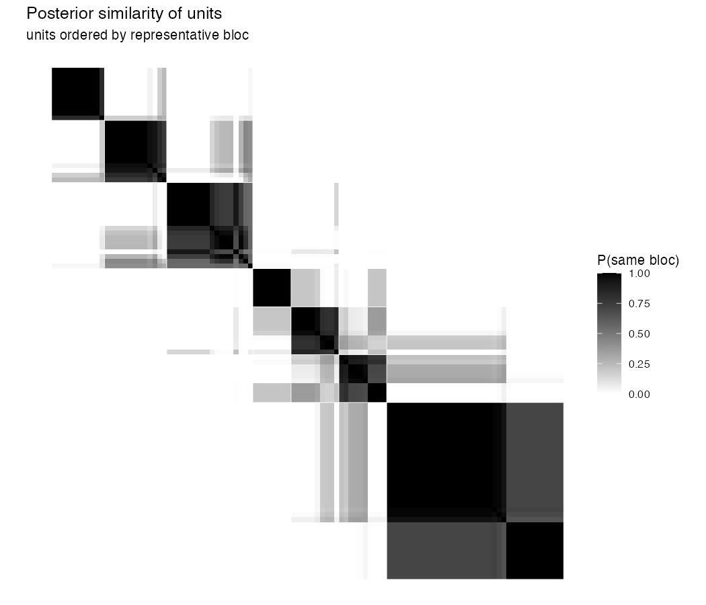
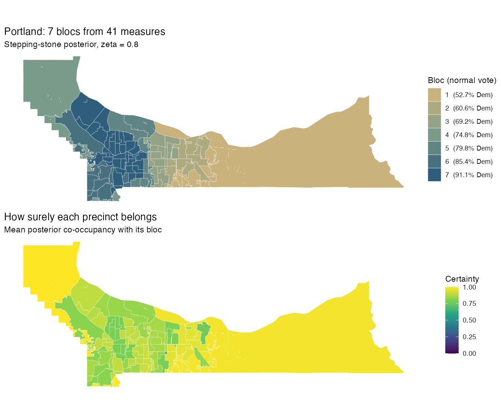
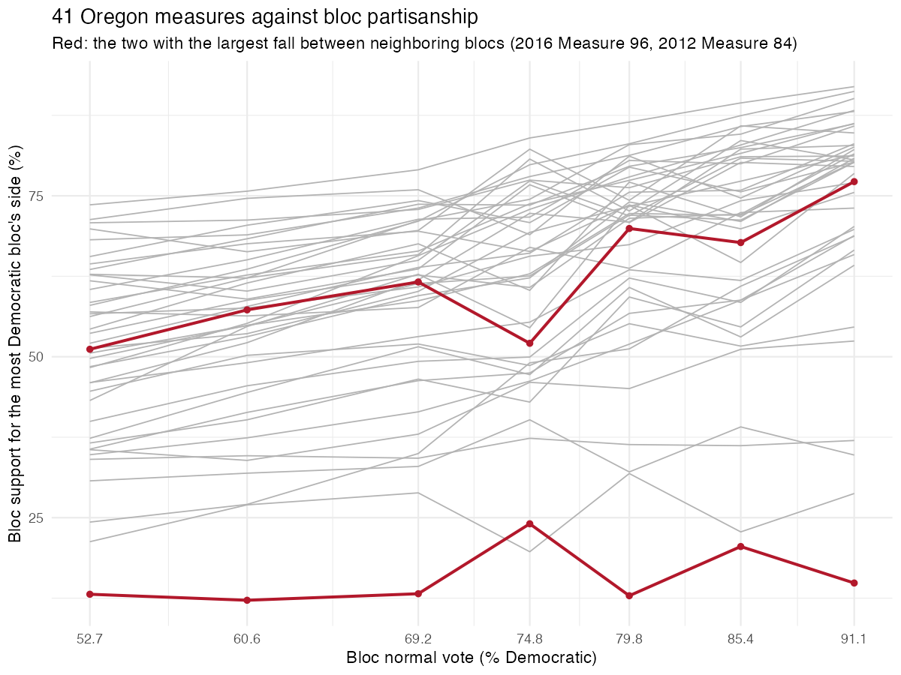
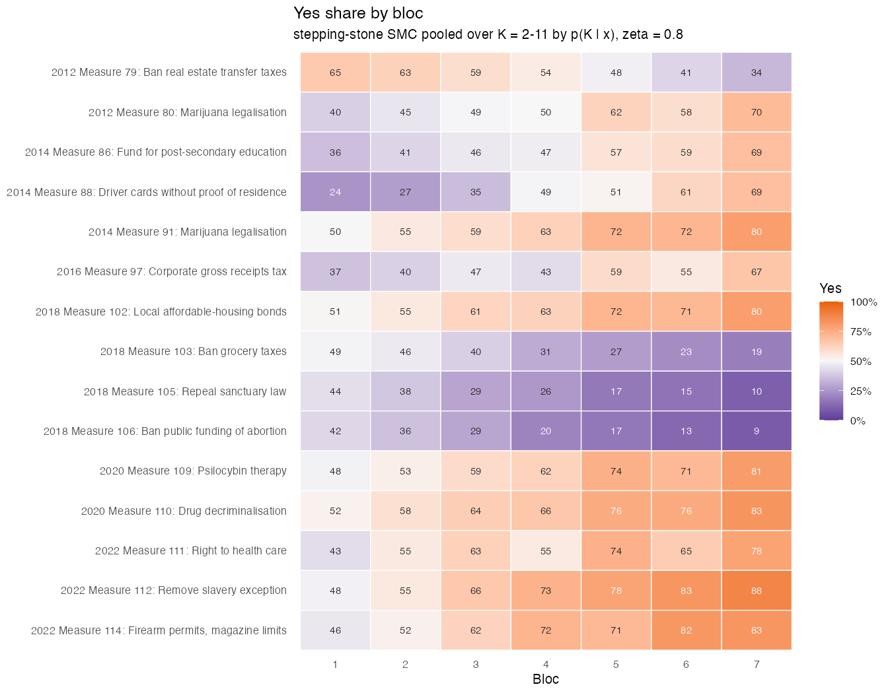
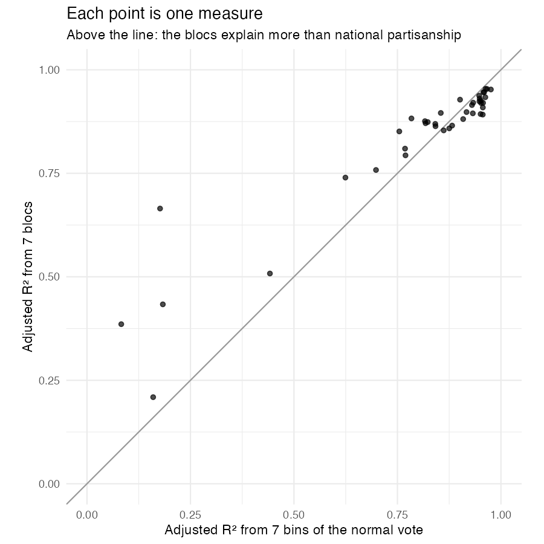
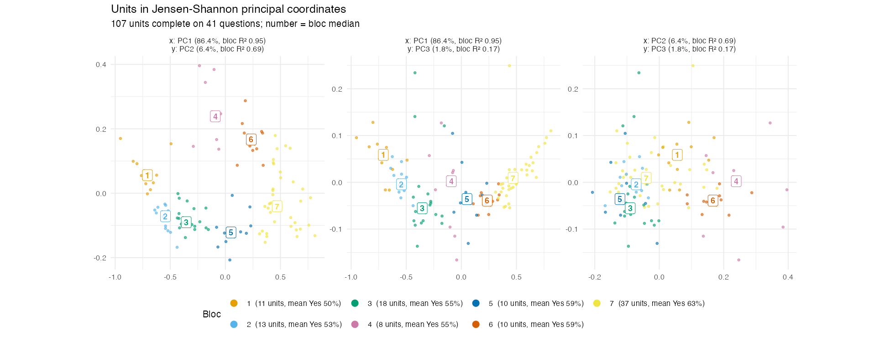

# Worked example: Portland (Multnomah County)

Portland is the paper's case of the *standard account*: local voting that follows national partisanship. Its 107 precincts run from about 53% to 91% Democratic, and most Oregon statewide measures split them along that axis. The example uses the fully Bayesian route through [Elections.BBMM](https://github.com/cascobayesian/Elections.BBMM), with no shortcuts:
- the stepping-stone posterior on the number of blocs;
- a single representative map drawn from the posterior sample;
- the paper's comparisons with partisanship, recomputed from that map.

It also shows why one stepping-stone run per *K* is not enough. With replicates, the posterior moves from the paper's five blocs to seven. The two extra blocs split a bloc the paper had to describe as an odd pairing: the affluent West Hills together with working-class east-side precincts.

```sh
Rscript examples/portland/portland_example.R
```

The stepping-stone runs are cached in `output/evidence_zeta0.8*.rds`, so the script takes about a minute. Delete those files to rerun them; four runs per *K* take about 40 minutes on 12 threads. The script needs:
- [Elections.BBMM](https://github.com/cascobayesian/Elections.BBMM) (`remotes::install_github("cascobayesian/Elections.BBMM")`);
- **cluster**, **dplyr**, **sf**, **ggplot2** and **patchwork**.

Everything is written to [`output/`](output/).

## 1. The data

```r
source("R/read_place.R")
d   <- read_place("portland")                    # Yes votes and Yes + No totals, precinct x measure
fed <- read_place("portland", "federal_races")   # Democratic and Dem + Rep votes, President 2012-24, Senate 2014-22
g   <- read_units("portland")                    # the 2022 precinct map
d
#> BBMM data: 107 units x 41 questions, 14,668,452 votes; 0.0% of cells empty
#> Median votes per cell 3,430; pooled Yes share 0.596
nv <- rowMeans(fed$X / fed$M, na.rm = TRUE)      # the normal vote: mean two-party Democratic share, 8 races
```

`read_place()` turns the long file `ballot_measures.csv.gz` into a `bbmm_data` object built by `bbmm_data(X, M, labels)`. Here `X` is the precincts × measures matrix of Yes votes and `M` the matching Yes + No totals. Earlier years were moved onto the 2022 map as described in [`data/portland/DATA.md`](../../data/portland/DATA.md).

## 2. How hard to listen to the data: ζ

The model raises the likelihood to a power ζ ≤ 1 (a *coarsened* posterior). The rest of the paper uses ζ = 0.3. With only 107 precincts, that leaves too little information to separate more than three blocs. Tempered EM is fast enough here to compare both settings: `bbmm_em_select()` runs `bbmm_em()` with ten random starts at each *K* and applies BIC and minimum-share rules.

```r
sel <- lapply(c(`0.3` = 0.3, `0.8` = 0.8), function(z)
  bbmm_em_select(d, K = 2:10, zeta = z, n_starts = 10, seed = 2026, cores = 10))
#> zeta = 0.3   Selected number of blocs:  BIC 3   min_share_3% 6   min_share_5% 6
#> zeta = 0.8   Selected number of blocs:  BIC 5   min_share_3% 8   min_share_5% 8
```



`plot_em_selection()` draws the BIC and the smallest bloc's share against *K*. We use ζ = 0.8, where BIC picks five blocs, matching the earlier EM fit. In the project's ζ grid, ζ = 0.75 to 0.9 all give five.

## 3. The posterior on the number of blocs

`bbmm_ss()` estimates the evidence log p(x | K) for one *K* by sequential Monte Carlo:
- 200 particles move from the prior (β = 0) to the coarsened posterior (β = ζ).
- Each step is chosen so that the particles' effective sample size stays high.
- Between steps, the particles are moved by Gibbs sweeps of the allocations, Jain–Neal split–merge proposals, and Metropolis updates of each bloc's Yes probabilities *p<sub>kq</sub>* and concentration ν<sub>k</sub>.

The product of the incremental weights estimates the evidence, and the final particles are a sample from the posterior at that *K*. `bbmm_evidence()` runs `bbmm_ss()` for each *K*, using the paper's priors: Beta(10, 10) on *p<sub>kq</sub>*, and ν<sub>k</sub> ~ Gamma(4, 0.04) truncated at 50.

```r
ev1 <- bbmm_evidence(d, K = 2:11, zeta = 0.8, seed = 2026, n_threads = 12)            # one run per K, ~10 min
ev2 <- bbmm_evidence(d, K = 2:11, zeta = 0.8, n_rep = 3, seed = 2027, n_threads = 12) # three more, ~30 min
ev  <- evidence_from_fits(c(ev1$fits, ev2$fits))                                       # pool: 4 runs per K
```

**One run per *K* is not enough.** Each run's log *Z* is a Monte Carlo estimate. Here the estimates for the same *K* differ by up to 50 log units, more than the gaps between neighboring *K*. The table gives each run's log *Z* relative to the best run overall:

```
 K    run 1   run 2   run 3   run 4
 5    -57.3   -53.6   -60.5   -63.8
 6    -72.3   -27.2   -74.9   -62.4
 7    -34.2   -56.2   -41.8   -37.5
 8    -44.4   -67.9   -16.4   -27.1
 9    -51.7   -54.8   -53.6     0.0
10    -64.2   -40.0   -57.0   -43.8
```

Any single column picks a different winner. The first alone gives p(K = 7) = 1.00. The paper's cluster runs (one per *K*, in [`paper_hpc_logZ.csv`](paper_hpc_logZ.csv)) give p(K = 5) = 1.00, because their *K* = 5 run happened to come out 33 log units above any of these four. `evidence_from_fits()` treats runs at the same *K* as replicates and averages their log *Z*. `posterior_K()` then adds the default geometric prior on *K* (`log_prior_K_geometric()`):

```r
ev
#>  K     logZ    sd posterior
#>  5 -6517668  4.37  2.49e-09
#>  6 -6517669 22.00  1.47e-09
#>  7 -6517652  9.67  2.53e-02
#>  8 -6517649 22.49  7.47e-01
#>  9 -6517650 26.71  2.27e-01
#> Posterior on occupied blocs T: 6: 0.27, 7: 0.73
```



*K* counts mixture components. *T* counts the blocs that actually hold precincts, and that is the quantity to report. Runs at *K* = 8 or 9 leave one or two components empty, so the posterior puts 0.73 on seven occupied blocs, 0.27 on six, and 0.0001 on five. Adding the paper's cluster runs as a fifth replicate per *K* gives p(T = 7) = 0.79 and p(T = 6) = 0.21.

## 4. One representative map

`bloc_summary(ev, d)` pools every particle of every run, weighting each by p(K | x) times its particle weight. From those draws it computes the *posterior similarity matrix* `psm[i, j]`: the probability that precincts *i* and *j* are in the same bloc. Two maps can be read from it:
- **The package's default:** Dahl's least-squares partition, the sampled partition closest to `psm`, here restricted to draws with exactly *T* occupied blocs (`n_blocs = T`).
- **The paper's representative coloring:** k-medoids on 1 − `psm` at *T*.

They agree exactly here (adjusted Rand index 1.000).

```r
s   <- bloc_summary(ev, d, n_blocs = 7)
pam <- cluster::pam(as.dist(1 - s$psm), k = 7, diss = TRUE)
#> T = 7; average silhouette 0.859; ARI(k-medoids, Dahl) = 1.000
```

The blocs are numbered by partisanship, 1 = least Democratic, as in the paper. The renumbered summary keeps the package's model estimates: *p<sub>kq</sub>* with 90% intervals, and ν<sub>k</sub>. Two columns need defining:
- **Certainty:** a precinct's mean posterior co-occupancy with the other members of its bloc.
- **Silhouette:** the k-medoids silhouette.

| Bloc | Precincts | Normal vote (% Dem) | ν (90% interval) | Certainty | Silhouette | Paper's bloc (T = 5) |
|---|---|---|---|---|---|---|
| 1 | 11 | 52.7 | 319 (261–386) | 0.97 | 0.96 | 1 |
| 2 | 13 | 60.6 | 705 (488–857) | 0.93 | 0.91 | 2 |
| 3 | 18 | 69.2 | 397 (339–607) | 0.81 | 0.76 | 3 |
| 4 | 8 | 74.8 | 123 (73–155) | 1.00 | 1.00 | 4 |
| 5 | 10 | 79.8 | 217 (112–264) | 0.89 | 0.86 | 4 |
| 6 | 10 | 85.4 | 326 (269–380) | 0.83 | 0.78 | 4 (7), 5 (3) |
| 7 | 37 | 91.1 | 135 (124–186) | 0.86 | 0.85 | 5 |



`plot_coclustering(s)` draws `psm` with precincts ordered by bloc. Blocs 1, 2, 3 and 7 are solid blocks. Blocs 4, 5 and 6 are distinct but trade some posterior mass with each other and with bloc 7, which is why some draws have six blocs.

## 5. The map



Shaded on one gradient, the blocs still run outward from the center of the city:
- **Bloc 7**, the most Democratic, holds the inner city on both sides of the Willamette.
- **Blocs 3 to 1** take East Portland beyond I-205, then Gresham, Troutdale and the rural east county.

What changes from the paper's map is its fourth bloc, which held the outer West Hills, Sauvie Island and several working-class east-side neighborhoods together. At *T* = 7 it splits into three blocs:
- **Bloc 4:** seven of its eight precincts are west of the river, including Sauvie Island.
- **Bloc 5:** entirely east-side.
- **Bloc 6:** mostly west-side, plus three precincts from the paper's most Democratic bloc.

The lower panel shades each precinct by its certainty. The east county and the outer west side are certain. The inner neighborhoods, where blocs 5, 6 and 7 meet, are less so.

## 6. Every measure against bloc partisanship

This is the paper's Figure (panel a). For each measure, the figure shows each bloc's ballot-weighted share on the side the most Democratic bloc took, with the blocs placed at their mean normal vote:

```r
#> 12 of 41 measures order the blocs exactly by partisanship; median rank correlation 0.96
```



Most lines still rise from left to right, but with seven blocs only 12 of 41 rise strictly; with the paper's five, 31 do. The breaks come at blocs 4 and 5. `plot_bloc_profiles(s, questions = ...)` shows the 15 measures with the widest spread:



Blocs 4 (West Hills) and 5 (east side) are five points apart in partisanship. They differ by 19 points on the 2022 right to health care, 18 on phasing out the estate tax, and 16 on the 2016 corporate gross-receipts tax. This is a class split on taxes and redistribution that the five-bloc map merged. Their mean absolute gap across all 41 measures is 7.8 points.

## 7. Blocs against national partisanship

These are the paper's Table 2 quantities, computed exactly as in the paper:
- adjusted R² from *T* equal-count bins of the normal vote (`dplyr::ntile`) against *T* bloc indicators;
- the gain in adjusted R² from adding blocs to a linear normal-vote regression.

All regressions are ballot-weighted.

```r
#> Median r^2 with the normal vote 0.89; 4 of 41 measures below 0.25
#>          K median_r2_bins median_r2_blocs blocs_win median_gain gain_ge_025
#> paper_T5 5          0.888           0.849        11       0.021           0
#> this_T   7          0.901           0.892        18       0.043           4
```



The first row, from the paper's five blocs ([`paper_blocs_T5.csv`](paper_blocs_T5.csv)), reproduces the paper's Portland row exactly. With seven blocs, Portland is still the place where partisanship explains most: the median measure has r² = 0.89 with the normal vote, and the blocs still trail the bins slightly at the median. But the blocs now win on 18 of 41 measures and double the median gain. Four measures clear the paper's bar for a *characteristic ballot* (a gain of at least 0.25) where none did before ([`output/questions_vs_partisanship.csv`](output/questions_vs_partisanship.csv)):

| Measure | r² with normal vote | Adjusted R², blocs | Gain from adding blocs |
|---|---|---|---|
| 2016 Measure 96: Lottery funds for veterans | 0.08 | 0.66 | 0.59 |
| 2024 Measure 118: Corporate tax rebate to residents | 0.07 | 0.39 | 0.32 |
| 2014 Measure 90: Top-two open primary | 0.13 | 0.43 | 0.31 |
| 2016 Measure 99: Outdoor school lottery funding | 0.53 | 0.74 | 0.26 |

## 8. One dominant axis

`js_pcoa(d)` needs no model. It treats each precinct's Yes share on each measure as a distribution, sums the Jensen–Shannon divergences between precincts over measures, and takes principal coordinates of the square-rooted distances. `plot_js_pca(d, s, orient = nv)` plots the first three coordinates in pairs, colored by bloc.

```r
#> JS principal coordinates: PC1 86.4%, PC2 6.4%; r^2 of PC1 with the normal vote 0.97, with bloc 0.95
```



In Portland, one axis carries 86% of the variation, and it is national partisanship (r² = 0.97). In San Francisco the first coordinate carries 64% and the second, which partisanship misses, 17%. Portland's extra blocs live on the remaining 14%. This is the sense in which Portland remains the standard account, even at seven blocs.

## 9. Against the paper's five blocs and the fast approximation

```r
#> ARI, these 7 blocs vs the paper's 5: 0.824
#>      these
#> paper  1  2  3  4  5  6  7
#>     1 11  0  0  0  0  0  0
#>     2  0 13  0  0  0  0  0
#>     3  0  0 18  0  0  0  0
#>     4  0  0  0  8 10  7  0
#>     5  0  0  0  0  0  3 37
#> ARI, k-medoids at k = 5 on the pooled co-occupancy vs the paper's 5: 0.912
#> ARI, tempered EM at zeta = 0.8, K = 5 vs the paper's 5: 0.482; vs these 7: 0.481
```

The seven blocs nest inside the paper's five: blocs 1–3 are identical, and the paper's bloc 4 splits three ways. Forcing five blocs out of the same pooled posterior recovers the paper's map closely (ARI 0.91). The paper's partition is therefore a coarser reading of the same posterior, not a different one; the replicates simply say the data support the finer one. Tempered EM at the same ζ and *K* = 5 lands somewhere else (ARI 0.48), a reminder that EM finds one local optimum, not the posterior.

## Functions used, and what they compute

| Function | Computes | Used for |
|---|---|---|
| `bbmm_data()` (via `read_place()`) | Yes and total matrices, labels | §1 |
| `bbmm_em_select()`, `bbmm_em()` | Tempered EM over *K*, random starts, BIC and minimum-share rules | §2, §9 |
| `plot_em_selection()` | BIC and smallest-bloc share by *K* | `em_selection.png` |
| `bbmm_ss()` (via `bbmm_evidence()`) | Stepping-stone SMC at one *K*: log *Z*, particles, p(T \| x, K) | §3 |
| `bbmm_evidence()` | `bbmm_ss()` over *K* and replicates; p(K \| x), p(T \| x) | §3 |
| `evidence_from_fits()` | Pools separately run `bbmm_ss()` fits into one evidence object | §3 |
| `posterior_K()`, `log_prior_K_geometric()` | p(K \| x) from log *Z* and a prior | §3 |
| `plot_evidence()` | log *Z* by run, p(K \| x), p(T \| x) | `evidence.png` |
| `bloc_summary()` | Pooled posterior similarity matrix, Dahl partition, certainty, bloc *p<sub>kq</sub>* and ν<sub>k</sub> | §4–7 |
| `plot_coclustering()` | The posterior similarity matrix | `coclustering.png` |
| `plot_bloc_profiles()` | Bloc Yes shares by measure | `bloc_profiles.png` |
| `js_pcoa()`, `plot_js_pca()` | Jensen–Shannon principal coordinates | §8 |
| `adjusted_rand()` | Agreement between partitions | §4, §9 |

## Files

- [`portland_example.R`](portland_example.R): the script.
- [`paper_hpc_logZ.csv`](paper_hpc_logZ.csv): log *Z* from the paper's cluster runs (one per *K*, same settings).
- [`paper_blocs_T5.csv`](paper_blocs_T5.csv): the paper's five-bloc map, in the same numbering.
- `output/blocs.csv`: each precinct's bloc, certainty, normal vote and silhouette.
- `output/bloc_table.csv`: the bloc table above.
- `output/questions_vs_partisanship.csv`, `output/paper_vs_this.csv`: §7.
- `output/evidence_zeta0.8.rds`, `output/evidence_zeta0.8_reps.rds`: the cached stepping-stone runs (particles included).
