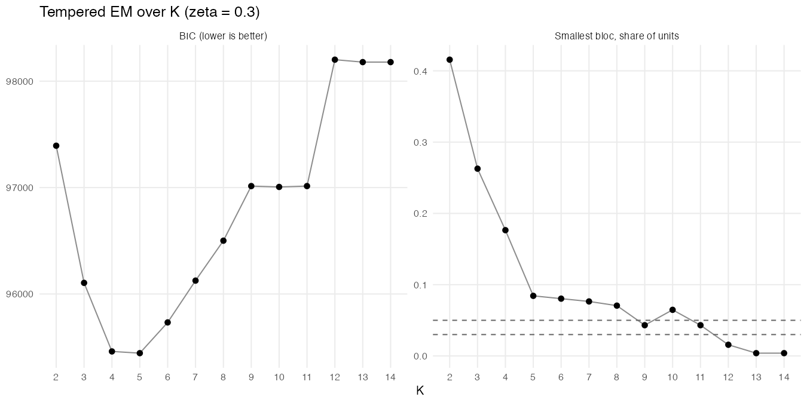
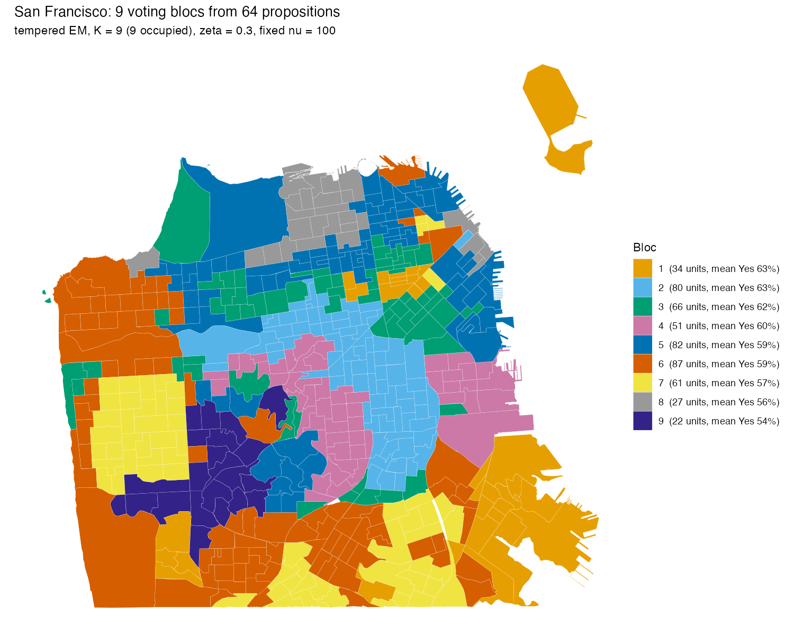
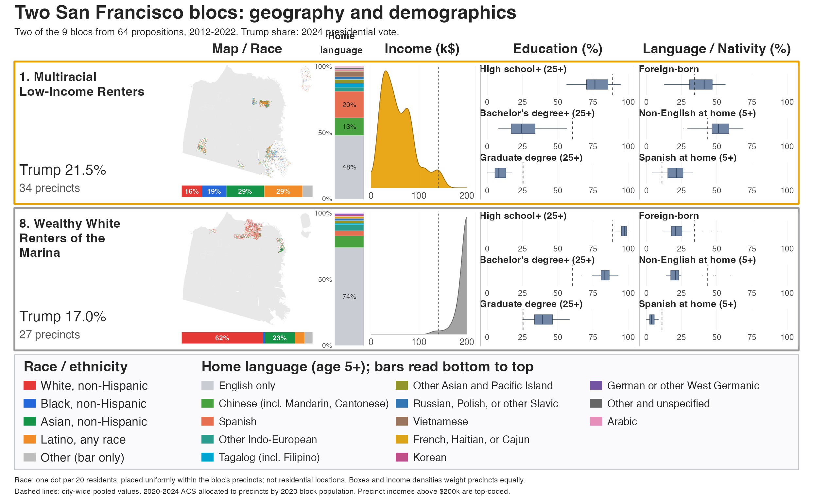
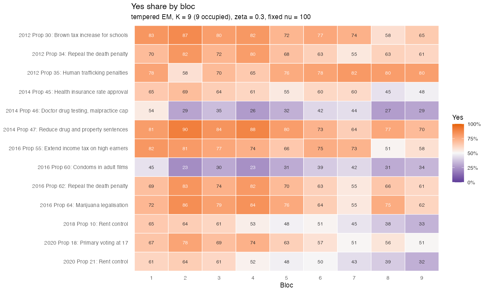
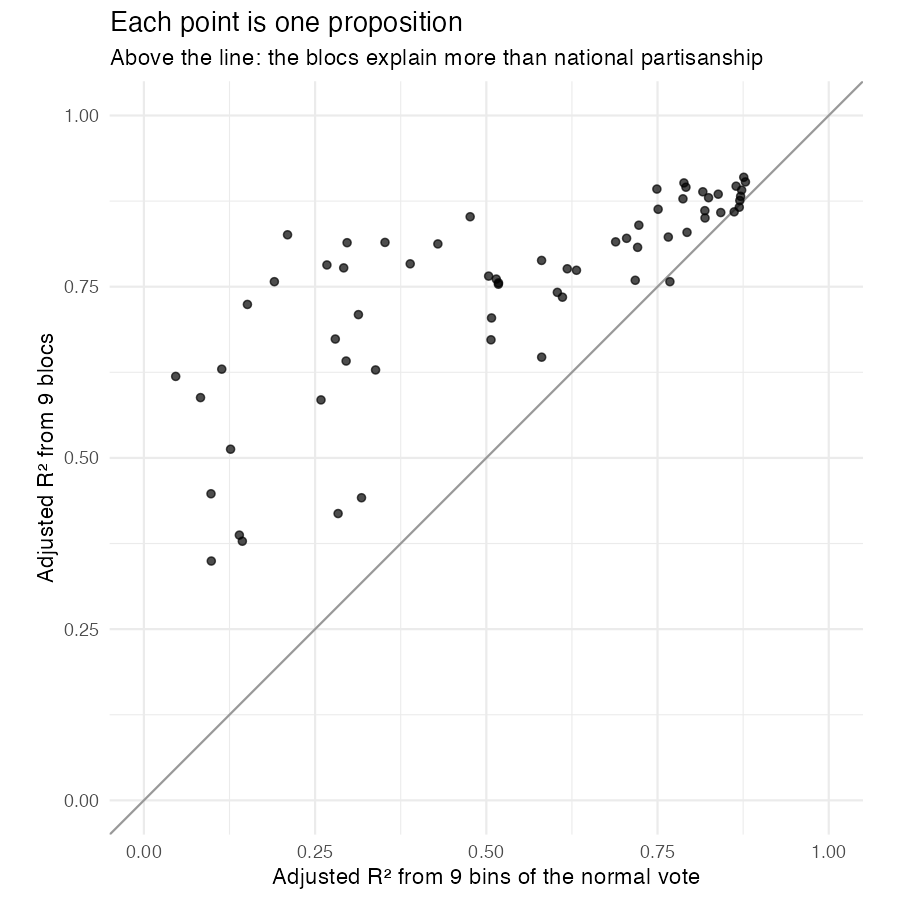
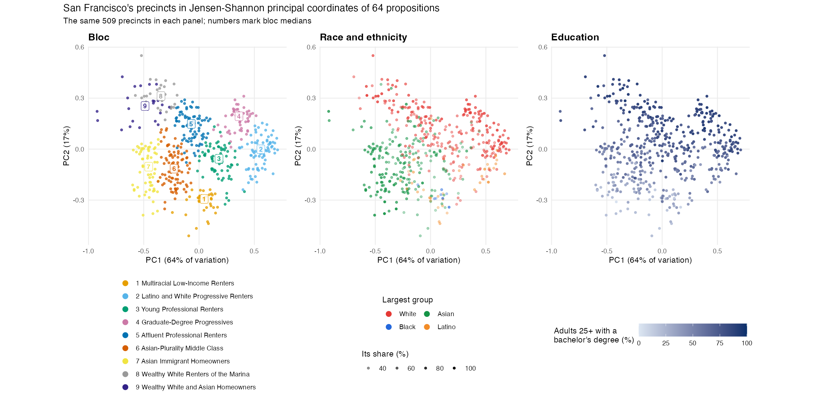

# Worked example: San Francisco

San Francisco votes on the same California propositions as the rest of the state, but every one of its neighborhoods is Democratic by any national standard: the least Democratic bloc below gave Democrats 77% of the two-party vote. National partisanship therefore has little room to separate its neighborhoods, which makes it a good place to see what the voting blocs add. This example fits the model to the city's 64 propositions of 2012–2022, maps the blocs, says who lives in them, and measures how much of each proposition they explain beyond national partisanship.

Everything below comes from two scripts, run from the repository root:

```sh
Rscript examples/san_francisco/sf_example.R     # the fit, map, profiles and partisanship comparison: about 5 minutes on 10 cores
Rscript examples/san_francisco/sf_demography.R  # bloc names, portraits and principal coordinates by race and education: about a minute
```

They need [Elections.BBMM](https://github.com/cascobayesian/Elections.BBMM) (`remotes::install_github("cascobayesian/Elections.BBMM")`), **sf**, **ggplot2**, **patchwork** and **ragg**, and write their figures and tables to `output/`. The demographics, 2020–2024 American Community Survey estimates allocated to the 510 precincts by 2020 census-block population, are in [`sf_demographics.csv.gz`](sf_demographics.csv.gz).

## 1. The data

```r
source("R/read_place.R")
d   <- read_place("sf")                    # Yes votes and Yes + No totals, precinct x proposition
fed <- read_place("sf", "federal_races")   # Democratic votes and Dem + Rep totals, President and US Senate
g   <- read_units("sf")                    # the 2024 precinct map
d
#> BBMM data: 510 units x 64 questions, 22,389,096 votes; 0.1% of cells empty
#> Median votes per cell 703; pooled Yes share 0.597
```

The units are San Francisco's 510 precincts on the 2024 map; returns from 2012–2022 were moved onto it through census blocks, weighted by registered voters ([`data/sf/DATA.md`](../../data/sf/DATA.md)).

## 2. Fitting the model

The fast route is tempered EM: for each number of blocs *K*, ten random starts, keeping the best. The likelihood is tempered by ζ = 0.3 (see the main [README](../../README.md#the-model)).

```r
sel <- bbmm_em_select(d, K = 2:14, zeta = 0.3, n_starts = 10, seed = 2026, cores = 10)
#>   K   loglik occupied  min_share     BIC converged n_at_best
#>   5 -46038.3        5 0.08431373 95444.1      TRUE         8
#>   ...
#>   9 -45472.3        9 0.04313725 97014.2      TRUE         1
#>  10 -45468.2        9 0.06470588 97006.1      TRUE         1
#>  12 -45390.6       11 0.01568627 98202.0      TRUE         1
#> Selected number of blocs:
#>          BIC min_share_3% min_share_5%
#>            5            9            9
```



BIC prefers five blocs; the rule of taking the largest *K* in which every bloc holds at least 5% of precincts gives nine, as does the 3% rule. Beyond nine, extra components either stay empty (at *K* = 10 and 11, still nine occupied) or carve off blocs of a few precincts. We use nine, the number the paper reports for San Francisco. Only one of the ten starts reaches the best fit at *K* = 9, so the exact boundaries between neighboring blocs are less settled than the overall pattern; the stepping-stone sampler in Elections.BBMM (`bbmm_evidence()`) puts uncertainty on both the number of blocs and the partition.

## 3. Where the blocs are

```r
fit <- sel$fits[["9"]]
s <- bloc_summary(fit, d)
plot_bloc_map(s, g)
```



The blocs are spatially coherent although the model knows nothing about geography: every precinct is assigned from its votes alone. We name them for who lives in them, using the census profile of each bloc (section 4, and [`output/bloc_profiles.csv`](output/bloc_profiles.csv)) and the neighborhoods it holds. The last column gives the paper's names (its Appendix D), matched to these blocs by overlap; seven of the nine match one paper bloc almost one-for-one (adjusted Rand index 0.78 between the two partitions).

| Bloc | Name | Precincts | Normal vote (% Dem) | Trump 2024 (%) | Where | Paper's bloc |
|---|---|---|---|---|---|---|
| 1 | Multiracial Low-Income Renters | 34 | 84.1 | 21 | Bayview–Hunters Point, the southeastern waterfront, the Tenderloin, Treasure Island | Low-Income Renters |
| 2 | Latino and White Progressive Renters | 80 | 93.8 | 7 | The Mission, Hayes Valley, Bernal Heights, the Castro, the Haight | Progressive Renters |
| 3 | Young Professional Renters | 66 | 87.7 | 14 | South of Market, the Inner Richmond, Nob Hill, the Western Addition | Young Professionals |
| 4 | Graduate-Degree Progressives | 51 | 93.3 | 6 | Noe Valley, Potrero Hill, Glen Park | Wealthy Progressives |
| 5 | Affluent Professional Renters | 82 | 85.8 | 14 | Pacific Heights, Russian Hill, the Financial District, Mission Bay | Affluent Renters |
| 6 | Asian-Plurality Middle Class | 87 | 81.0 | 24 | The Outer Richmond, Oceanview, Merced and Ingleside, the Excelsior | Middle-Class Mixed |
| 7 | Asian Immigrant Homeowners | 61 | 76.6 | 30 | The Sunset and Parkside, Visitacion Valley, Portola | Asian Homeowners and Asian Immigrant Families (two blocs in the paper) |
| 8 | Wealthy White Renters of the Marina | 27 | 79.9 | 17 | The Marina, Cow Hollow, Sea Cliff | Wealthy Moderates (its Marina half) |
| 9 | Wealthy White and Asian Homeowners | 22 | 78.0 | 21 | St. Francis Wood, Forest Hill, West Portal | Wealthy Moderates (its west-of-Twin-Peaks half) |

The differences from the paper are one merge and one split: this fit joins the paper's two Asian-majority blocs, and divides its Wealthy Moderates into the Marina's renters and the homeowners west of Twin Peaks. The paper's fit was made with different settings (see the note at the end of the main README).

## 4. Who is in the blocs

`sf_demography.R` profiles each bloc from the census: population-weighted racial and ethnic shares, nativity, education and homeownership, and the median of its precincts' median household incomes.

| Bloc | White | Black | Asian | Latino | Foreign-born | BA+ | Graduate degree | Own their home | Median precinct income |
|---|---|---|---|---|---|---|---|---|---|
| 1 Multiracial Low-Income Renters | 16 | 19 | 29 | 29 | 40 | 28 | 10 | 18 | $48k |
| 2 Latino and White Progressive Renters | 48 | 4 | 16 | 23 | 25 | 67 | 28 | 33 | $162k |
| 3 Young Professional Renters | 37 | 6 | 33 | 16 | 34 | 62 | 25 | 24 | $120k |
| 4 Graduate-Degree Progressives | 57 | 2 | 20 | 11 | 22 | 83 | 43 | 46 | $200k+ |
| 5 Affluent Professional Renters | 46 | 4 | 32 | 11 | 31 | 74 | 34 | 33 | $169k |
| 6 Asian-Plurality Middle Class | 24 | 4 | 48 | 18 | 41 | 47 | 16 | 58 | $131k |
| 7 Asian Immigrant Homeowners | 17 | 2 | 62 | 13 | 49 | 41 | 13 | 65 | $135k |
| 8 Wealthy White Renters of the Marina | 62 | 2 | 23 | 7 | 25 | 84 | 40 | 35 | $200k+ |
| 9 Wealthy White and Asian Homeowners | 39 | 2 | 40 | 10 | 31 | 72 | 34 | 84 | $200k+ |

*Percentages; BA+ and graduate degrees among adults 25 and over. Incomes are top-coded at $200,000.*

Three things sort the blocs: race and nativity, which separate the Asian-majority west and south (6 and 7) from the rest; education, which runs from 28% college graduates in bloc 1 to 84% in bloc 8; and tenure, which separates renters and owners at the same income (5 and 8 rent, 9 owns). The portraits below show two blocs at opposite ends of the class divide, in the format of the paper's Appendix D dashboards.



**Multiracial Low-Income Renters (1)** joins the southeastern waterfront (Bayview–Hunters Point and Hunters Point Shipyard) with the Tenderloin and Treasure Island, neighborhoods that touch nowhere on the map. It is the city's only bloc with no racial majority: 29% Asian American, 29% Latino, 19% Black and 16% white, and it is home to more of the city's Black residents (29%) than any other bloc. Its median precinct income, $48,000, is a third of the city's, fewer than three in ten adults hold a college degree, and 82% of households rent. Half of its residents speak a language other than English at home, Spanish (20%) and Chinese (13%) most of all. Its partisanship is unremarkable for San Francisco, a normal vote of 84% Democratic, and gave Trump 21% in 2024.

**Wealthy White Renters of the Marina (8)** holds the Marina, Cow Hollow and Sea Cliff. It is the whitest bloc (62%), the best educated (84% college graduates, 40% with graduate degrees), and five of every eight of its precincts have median incomes at the $200,000 cap. Yet two-thirds of its households rent: these are high-earning renters, not the homeowners of bloc 9. Three-quarters speak only English at home.

The two are four points apart in partisanship (normal votes of 84 and 80), so national partisanship barely tells them apart. On the propositions, they differ by 10 points on the average question and by more than 10 points on 30 of the 64. The largest gaps are on taxes, housing and health care: the 2016 extension of the income tax on high earners (82% Yes against 51%), the 2018 rent-control initiative (65% against 38%), the 2012 Brown tax increase for schools (83% against 58%), and the dialysis and health-insurance initiatives (21 points each).

## 5. What the blocs vote for

`distinctive_questions()` lists, for each bloc, the propositions on which it departs most from the city as a whole; `plot_bloc_profiles()` shows the blocs' Yes shares on a selection of them.



Two contrasts carry most of the structure. The first is the familiar progressive–moderate axis: repealing the death penalty, legalizing marijuana and restoring parolees' voting rights run from 82–90% in the Mission and Noe Valley blocs (2 and 4) to 55–62% among the Asian Immigrant Homeowners of the Sunset (7). The second is class, and it cuts across the first. On the 2016 extension of the income tax on high earners (Proposition 55), the Multiracial Low-Income Renters (1) voted 82% Yes and the Marina's renters (8) 51%; on the two rent-control initiatives of 2018 and 2020, bloc 1 was 22 to 32 points more supportive than the two wealthy blocs of the north and west (8 and 9).

## 6. Beyond national partisanship

Each precinct's **normal vote** is its mean two-party Democratic share across the presidential and Senate races in `federal_races.csv.gz`. For every proposition we compare two ballot-weighted regressions with the same degrees of freedom: Yes share on nine equal-count bins of the normal vote, and Yes share on the nine blocs.

```r
#> Median r^2 with the normal vote: 0.54; 12 of 64 propositions below 0.25
#> Median adjusted R^2: 9 bins of the normal vote 0.58, 9 blocs 0.78; blocs explain more on 61 of 64
```



National partisanship explains about half the variance in the typical proposition and almost none in a fifth of them. The blocs, estimated without any partisan information, explain more than the binned normal vote on 61 of the 64 propositions. The largest gains come on questions the parties barely take sides on ([`output/questions_vs_partisanship.csv`](output/questions_vs_partisanship.csv)):

| Proposition | r² with normal vote | Adjusted R², blocs | Gain from adding blocs |
|---|---|---|---|
| 2016 Prop 55: Extend income tax on high earners | 0.20 | 0.83 | 0.63 |
| 2022 Prop 29: Dialysis clinic requirements | 0.04 | 0.62 | 0.59 |
| 2018 Prop 8: Dialysis clinic revenue cap | 0.17 | 0.76 | 0.59 |
| 2020 Prop 23: Dialysis clinic requirements | 0.15 | 0.72 | 0.58 |
| 2018 Prop 3: Water bond | 0.05 | 0.59 | 0.55 |

The partisan-matched pairs make the same point. Latino and White Progressive Renters (2) and Graduate-Degree Progressives (4) have normal votes half a point apart (93.8 and 93.3), so national partisanship cannot tell them apart, yet they split by 11 and 12 points on the 2018 and 2020 rent-control initiatives. These numbers match the paper's San Francisco row (median bins 0.58, blocs 0.79, blocs ahead on 62 of 64; the same characteristic ballots).

## 7. The precincts in principal coordinates

A second view of the same structure needs no model. `js_pcoa()` computes the Jensen–Shannon distance between every pair of precincts across the 64 propositions and takes its principal coordinates. The figure plots the first two coordinates three times, colored by bloc, by each precinct's largest racial or ethnic group (fainter where that group is a smaller share), and by the share of adults with a bachelor's degree.



```r
#> JS principal coordinates: PC1 64.4%, PC2 17.2% of the variation; 509 precincts on 64 propositions
#> R^2 of PC1, PC2 on: blocs 0.94, 0.75; race shares 0.43, 0.59; BA+ share 0.09, 0.69; normal vote 0.89, 0.04
```

The first coordinate, two-thirds of the variation, is the progressive–moderate axis, and it is national partisanship (r² = 0.89 with the normal vote): it runs from the Sunset, the Marina and west of Twin Peaks (blocs 7, 8 and 9) on the left to the Mission and Noe Valley (2 and 4) on the right. Education says almost nothing about it (r² = 0.09): the Marina and Noe Valley are equally well educated and sit at opposite ends. The second coordinate is the one partisanship misses (r² = 0.04). It is class: the college-educated share explains 69% of it, and it separates the Multiracial Low-Income Renters (1) at the bottom from the wealthy blocs (4, 8 and 9) at the top, whatever their partisanship. Race runs along both axes, from mostly white precincts at the upper right to mostly Asian ones at the lower left; the racial and ethnic shares together explain 43% and 59% of the two coordinates. The blocs explain 94% and 75%. The two portrait blocs, 1 and 8, are the furthest apart of any pair on the second coordinate, although their normal votes differ by four points.

## 8. Federal races in the model

`combined.csv.gz` adds the nine presidential and Senate races to the 64 propositions. Fitting the same model to both:

```r
both <- read_place("sf", "combined")
fit_both <- bbmm_em(both, K = 9, zeta = 0.3, n_starts = 10, seed = 2026)
#> Adjusted Rand index, blocs from measures only vs measures + federal races: 0.69
```

The partition changes noticeably (adjusted Rand index 0.69): nine candidate races among 73 contests pull the blocs toward the partisan axis. The paper's San Francisco blocs use the propositions only, so that the comparison with partisanship in section 6 is not circular.

## 9. Going further

- The fully Bayesian fit: `bbmm_evidence(d, K = 2:14, zeta = 0.3, n_threads = 10)` gives the posterior on the number of blocs by stepping-stone sampling (hours rather than minutes; see the [Elections.BBMM tutorial](https://github.com/cascobayesian/Elections.BBMM/blob/main/TUTORIAL.md)).
- `plot_js_pca(d, s)` shows the first three Jensen–Shannon principal coordinates in pairs, colored by bloc ([`output/js_pca.png`](output/js_pca.png)).
- [`data/sf/other/candidate_contests.csv.gz`](../../data/sf/other/) holds the city's mayoral, district-attorney and other nonpartisan contests of 2018–2024 on the same precincts, which the paper uses to show that the coalitions behind candidates recur across elections.
- Every other place in [`data/`](../../data/) loads the same way: `read_place("nyc")`, `read_place("co")`, …
