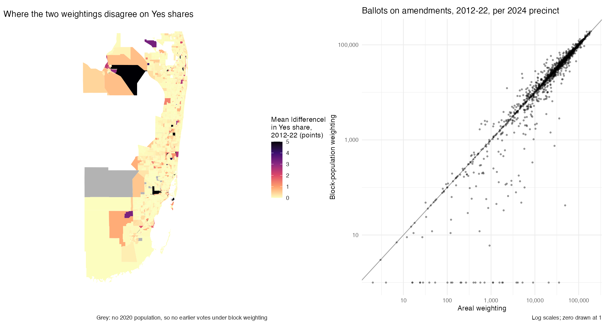
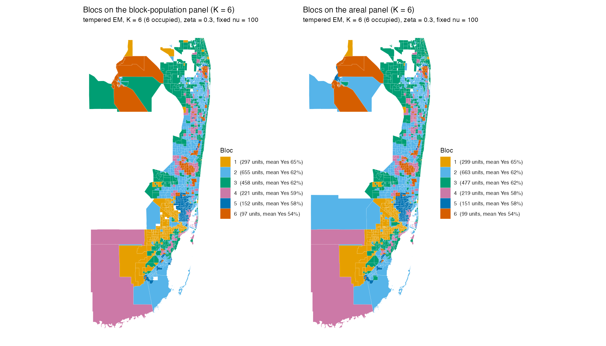

# Worked example: aligning South Florida's precincts across seven elections

The model needs every election counted on the same units. Precinct lines move between elections, so each year's returns have to be moved onto one map first. This example walks through the project's alignment procedure for Broward, Miami-Dade and Palm Beach counties:
- 45 statewide constitutional amendments and 9 federal races, 2012–2024;
- moved onto the 1,914 precincts of the 2024 map;
- with a crosswalk built from 2020 census block populations (the method first used for New York City).

At the end the example compares the result with simple areal weighting, which spreads each old precinct's votes evenly over its land. That is how the panel in [`data/south_florida/`](../../data/south_florida/) was made. The comparison checks whether the choice changes the data, and whether it changes the blocs.

```sh
Rscript examples/south_florida/sfl_alignment.R
```

The alignment itself takes under a minute. Step 9 fits the model to both panels, which takes about 10 minutes the first time (the fits are cached in `output/em_selection.rds`). The script needs **dplyr**, **tidyr**, **sf**, **ggplot2**, **patchwork** and, for step 9, [Elections.BBMM](https://github.com/cascobayesian/Elections.BBMM). Everything is written to [`output/`](output/).

## The inputs

The raw downloads total about 1 GB, so the example starts from small files in [`inputs/`](inputs/). [`prepare_inputs.R`](prepare_inputs.R) makes them from the raw files and documents every source. You do not need to run it.

| File | What it holds | Raw source |
|---|---|---|
| `native_votes.csv.gz` | every reporting unit's Yes/No votes on the 45 amendments and its DEM/REP votes for President, US Senate and Governor | Florida Division of Elections, [precinct-level results](https://dos.fl.gov/elections/data-statistics/elections-data/precinct-level-election-results/) |
| `unit_map.csv.gz` | the polygon(s) each reporting unit was placed on, and how | the statewide Florida build's id resolver (see step 2) |
| `polygon_tallies.csv.gz` | the D and R votes VEST attached to each polygon, for one office per year | VEST precinct shapefiles, 2012–2024 |
| `precinct_ids.csv.gz` | every precinct id in each year's map | the same shapefiles |
| `blocks.csv.gz` | every 2020 census block: population, land area, and the precinct holding it in each of the seven maps | 2020 TIGER/Line blocks with `POP20` |
| `areal_fallback.csv.gz` | for the few polygons that contain no block: their area shares of the 2024 precincts | shapefiles |

## 1. The native returns

Each county reports its own units, and their number changes a lot from year to year: Broward went from 778 units in 2012 to 358 in 2024.

```
  county 2012 2014 2016 2018 2020 2022 2024
  BRO     778  577  577  577  577  355  358
  DAD    1048  814  783  783  866 1053  762
  PAL     765  844  806  873  872  795  799

  year amendments     votes
  2012         11  20,990,091
  2014          3   3,762,766
  2016          4   9,150,076
  2018         12  23,527,622
  2020          6  15,866,369
  2022          3   4,964,661
  2024          6  15,189,317
```

Only statewide amendments are kept. County and municipal questions on the same ballots are dropped by name (`amendments()` in `prepare_inputs.R`). Every vote count is kept at the unit where the county reported it. Nothing is moved yet.

## 2. Which units are places, and where they are

A reporting unit's id does not reliably name a polygon. Across Florida, counties encode precincts in at least eight ways. In South Florida:
- Miami-Dade 2012 reports precinct × 10 (`0010` is precinct 1.0);
- Miami-Dade 2020 and 2022 need the label, not the code (`9897` is precinct 995.0);
- Palm Beach 2016 reports some units as lists of precincts (`1002, 1003, …`).

The statewide build's resolver tried every candidate key per county-year and kept the one that placed the most votes. Where no key worked, it matched units by their vote counts ("fingerprint"). The share of votes placed by each route:

```
  year unique unique_div10 precinct fingerprint
  2012   61.8         38.2      0           0
  2014  100            0        0           0
  2016  100            0        0           0
  2018  100            0        0           0
  2020   60.1          0       39.9         0
  2022   29.2          0       38.5        32.3
  2024  100            0        0           0
```

Three kinds of unit are not places:
- **Federal-only units** carry candidate votes but no amendments. These are mainly Miami-Dade's overseas pseudo-precincts 100.1–100.9, with 11,217 votes in all. They are excluded, which leaves the amendments untouched.
- **Unplaced units** (39 votes here) are spread over the county's units in proportion to their votes for the same contest and side. This is VEST's convention. Elsewhere in Florida the same rule handles countywide absentee and early-vote rows, such as half of Polk County's 2012 vote.
- **Countywide units:** there are none in these three counties.

## 3. Reporting groups

One unit can cover several polygons, and one polygon can be shared by several units. Either way, the votes cannot be split between those polygons from the returns alone. So units that share a polygon are merged into one *reporting group* by union-find. A polygon with no votes that is named in a unit's member list joins that unit.

```
  county groups_2012 … groups_2016 … groups_2024 | multi-polygon groups
  PAL           762          693           798  | 50 in 2016, none in any other county-year
```

The 50 multi-polygon groups are Palm Beach's consolidated 2016 reporting: unit 1018, for example, reports for polygons 1002–1014. Their votes are moved as one block of territory, never pinned to the lead polygon.

## 4. Are the units on the right polygons?

Ids alone cannot settle this. VEST built its shapefiles by joining these same DOS files, so every polygon carries VEST's count of the D and R votes for one office. A group is placed correctly when its own tallies equal its polygons' VEST tallies ([`output/vest_check.csv`](output/vest_check.csv)):

```
  county year pct_votes_exact pct_votes_within_2pct
  BRO     all           100                   100
  PAL     2016         97.3                  97.3     (the consolidated groups)
  PAL     other         100                   100
  DAD     2012         15.9                  99.8
  DAD     2016          2.3                  93.5
  DAD     2018         12.9                  93.9
  DAD     2020–24    1.2–15.4                 100
```

Broward and Palm Beach match to the vote. Miami-Dade almost never matches exactly, because VEST spread the county's absentee and early votes into its precincts and DOS did not. Group totals still agree within 2% for 94–100% of votes. That is the signature of a correct placement with redistributed absentees, not of misplaced units.

## 5. The crosswalk

This is the core of the method. Every 2020 census block is assigned **whole** to one precinct in each year's map:
1. by its internal point;
2. if that falls outside every precinct (water, a gap in the map), by its largest overlap;
3. otherwise by the nearest precinct within 100 m.

The internal point places all but a few hundred of South Florida's 6.1 million people in every year. A reporting group's votes then go to the 2024 precincts in proportion to the group's 2020 population in each:

  w(g → t) = population of the blocks in both g and t ÷ population of g

Blocks are never split by area. Two fallbacks cover the rest:
- **land area of the blocks** when a group's blocks have no people;
- **plain area overlap** when a group contains no block at all.

Between them they move 0.05–0.11% of each year's votes. The weights are in [`output/crosswalk.csv.gz`](output/crosswalk.csv.gz). The share of each year's amendment votes whose group lands (≥ 99%) in a single 2024 precinct:

```
  year  2012  2014  2016  2018  2020  2022  2024
  %     73.6  72.3  74.5  76.6  76.1  94.6  100
```

So about a quarter of the pre-2022 vote has to be divided between 2024 precincts. The 2022 map is close to 2024's.

The fractional estimates are rounded to whole votes by largest remainder, within county × contest × side. That keeps every county total exact.

## 6. Validation

Three checks, each of which must pass:

```
Conservation: 342 county x contest x choice cells, max |gap| = 0 votes; 55 votes lost (no block, no overlap)
Identity: 2024 reproduces itself in 30608 of 30608 single-polygon precinct x contest x choice cells
Plausibility: precinct Dem share 2020 vs 2024, r = 0.956 (1758 precincts)
              the same on the areal panel, r = 0.958
```

- **Conservation:** aligned votes plus excluded votes equal the native votes in every cell ([`output/validation_conservation.csv`](output/validation_conservation.csv)). The 55 lost votes belong to a handful of tiny 2012–20 Palm Beach polygons that contain no block and do not touch 2024 land.
- **Identity:** the target election passes through the crosswalk unchanged.
- **Plausibility:** a precinct's 2020 presidential vote, moved, should predict its 2024 vote, which was not moved. The two correlate at 0.956. That is lower than in most places because South Florida swung hard toward Trump in 2024, unevenly. The areal panel gives the same 0.958.

## 7. Block population against areal weighting

The two panels share the returns, the id placement, the reporting groups and the 2024 map. They differ only in the weights. For yes shares, the weighting barely matters ([`output/block_vs_areal_by_year.csv`](output/block_vs_areal_by_year.csv)):

```
  year r_yes_share median_abs_diff_pts pct_cells_over_5pts median_ballot_ratio pct_ballots_off_25pct
  2012      0.9977                0.04                0.60                   1                  13.5
  2014      0.9994                0.04                0.21                   1                  13.9
  2016      0.9994                0.02                0.18                   1                  15.0
  2018      0.9984                0.03                0.22                   1                  11.6
  2020      0.9994                0.02                0.20                   1                  12.3
  2022      0.9998                0.00                0.02                   1                   1.5
```

Ballot counts are another matter. In each year from 2012 to 2020, 12–15% of precincts get ballot counts more than 25% apart under the two methods. Over 2012–22, 100 precincts differ by more than a factor of two. These counts set how much each precinct weighs in the model.



The differences sit where people are spread unevenly within the old precincts: large precincts at the urban edge and in the Everglades, and non-residential land inside the city. **28 precincts** have almost no 2020 residents (none in 25 of them, 57 people in all) and cast no amendment votes in 2024. They are drawn in grey on the map and along the bottom of the scatter. Areal weighting gives them 53,392 historical ballots, because their land overlaps old precincts whose voters lived elsewhere. Miami-Dade 234.0 alone gets 20,638. Block weighting gives them none.

Whole-block assignment has a blind spot of its own. A precinct too small to contain any block's internal point gets no blocks. Six 2024 precincts are like this. Where the same small precinct exists in earlier maps (Miami-Dade 100.0, with 7,083 amendment ballots in 2024, is the largest), the area-overlap fallback carries its earlier votes across.

## 8. Do the blocs care?

Step 9 of the script fits the same tempered EM to both panels: ζ = 0.3, *K* = 2–12, 10 starts each, with the bloc count chosen by the 5% rule.

```
5% rule: K = 6 (block) and 6 (areal); ARI between the two maps = 0.912
     areal
block   1   2   3   4   5   6
    1 287   2   8   0   0   0
    2   3 630  18   2   1   1
    3   0  11 447   0   0   0
    4   0   5   2 213   0   1
    5   0   1   0   3 146   2
    6   0   0   1   0   2  94
```



Both panels give six blocs, with mean Yes shares within a point of each other, and BIC picks nine on both. Of the 1,880 precincts in both fits, 1,817 (96.6%) land in the same bloc. The most visible moves on the map are large, thinly settled precincts in western Palm Beach. The Everglades precinct that areal weighting fills with voters drops out of the block-population fit, because it has no votes there. In this place the blocs are robust to the weighting. The ballot counts are not, so the block-population panel is the one to trust for anything weighted by turnout.

## 9. The aligned panel

[`output/ballot_measures.csv.gz`](output/ballot_measures.csv.gz) and [`output/federal_races.csv.gz`](output/federal_races.csv.gz) use the repository's format (`unit_id, question_id, year, type, yes, total`). They can replace the files in `data/south_florida/`. `unit_id` matches `data/south_florida/units.gpkg`. The panel has 1,914 precincts, 45 amendments and 9 federal races.

## Doing this for a new place

The same steps, in the same order:
1. **Check feasibility:** precinct returns for every election, precinct maps for every year, and statewide measures in the returns.
2. **Parse** the returns to one long native table.
3. **Separate non-geographic units** and decide how to allocate them.
4. **Validate native totals** against certified results.
5. **Choose the target map**, normally the latest general election.
6. **Place each year's units** on that year's map, and verify the placement against embedded votes where they exist.
7. **Build the block crosswalk.**
8. **Align, round by largest remainder, and validate:** conservation, identity, plausibility.

The project's New York City, Philadelphia and statewide builds all follow it. Each place's `DATA.md` records the choices made.
